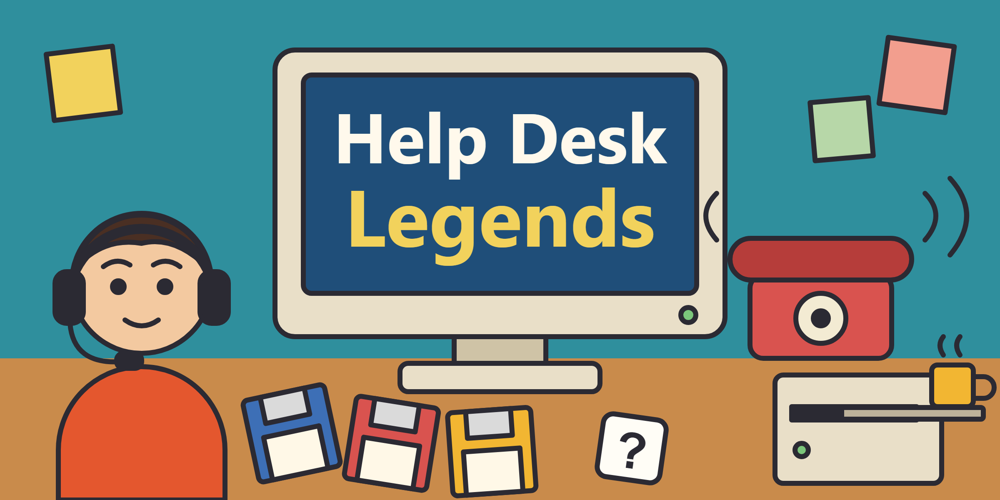

# Help Desk Legends

Help Desk Legends is a quiz game about the funny calls that tech support workers say they have answered, for one player or a group sharing a screen, age ten and up.

## Play It

[https://jeremynyc4.github.io/game-04-help-desk-legends/](https://jeremynyc4.github.io/game-04-help-desk-legends/)

You need a phone or a computer with a web browser. One person can play alone, or a group can share one screen and vote on each answer.

## How to Play

1. Choose how many calls to answer: three, eight, or 15.
2. Tap Start My Shift.
3. Read the call, then tap the ending you think the story has. There are four endings, and only one is right.
4. Tap Next Call to keep going. You get one tap per call.
5. At the end, see how many calls you solved and what job title you earned. Tap Play Again for a new set of calls.

The calls are tall tales that tech workers have passed around for years. Most of them probably never happened.

## Play Test Log

| Round | Who played | Where they got stuck | What I changed |
| --- | --- | --- | --- |
| 1 | the AI that built it, tapping through all 15 calls on a phone-sized screen | Nowhere in the game, but the sides of the pictures were cut off on a phone. | Made each picture shrink to fit the width of a narrow screen. |
| 2 | me | Nowhere, but the picture behind each call gave the answer away. | Drew all four endings into every picture, so the picture no longer points to one of them. |
| 3 |  |  |  |

## Made with

Built with Claude Code in Vibe Coding for Nonprofits, a Whole Whale × Meet the Moment accelerator.
